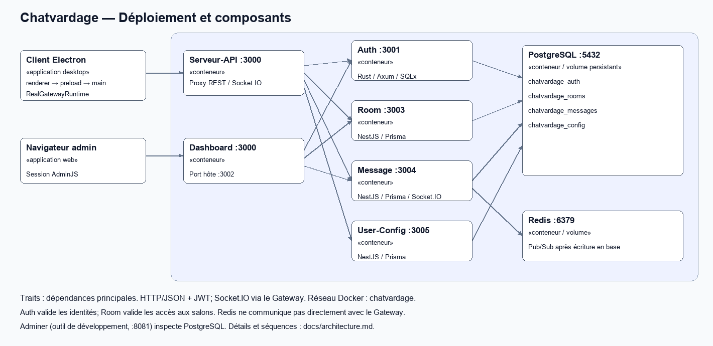

# Chatvardage — Infrastructure et documentation

Point de départ du projet complet : client Electron, API Gateway, quatre services métier, Dashboard d’administration, PostgreSQL et Redis. Ce dépôt orchestre les conteneurs et rassemble la documentation. Chaque service conserve son code, ses tests et ses migrations.

## Prérequis

- Git et accès aux huit dépôts privés de l’organisation **Chatvardage**.
- Docker Engine 25+ / Docker Desktop avec Compose v2; Docker démarré.
- Bash sous Linux/macOS ou WSL sous Windows pour les scripts. Les commandes ci-dessous sont en Bash/WSL.
- Pour le client desktop depuis les sources : Node.js 22, npm et un bureau graphique. Le backend n’exige ni Rust, ni Node, ni PostgreSQL installés sur l’hôte.
- Ports locaux libres : 3000 à 3005, 5432, 6379 et 8081. Ne pas lancer les Compose individuels en même temps que la stack globale.

## Installation complète

Cloner les huit dépôts ci-dessous côte à côte.

```bash
mkdir Chatvardage
cd Chatvardage
for repo in Infra Frontend Serveur-API Authentification Room-Service Message-Service User-Config-Service Dashboard; do
  git clone --branch main "git@github.com:Chatvardage/A26_5A6_01-$repo.git"
done
cd A26_5A6_01-Infra
```

Aucun `.env` à préparer : au premier `docker compose up`, le service `generer-env` (conteneur Alpine) exécute `scripts/generer-env.sh`. Il crée `.env` à partir de `.env.example` avec dix secrets aléatoires distincts (PostgreSQL, Redis, JWT, jeton interne, Dashboard). Les autres services attendent cette étape, puis chargent ce fichier au démarrage. Un `.env` existant est conservé : les secrets restent stables d’un démarrage à l’autre.

Pour régénérer les secrets : `./scripts/generer-env.sh --force` (ou `.\scripts\generer-env.ps1 -Force` en PowerShell). PostgreSQL et Redis gardent alors les anciens identifiants dans leurs volumes : réinitialiser les volumes (`docker compose down -v`, qui efface les données) avant de redémarrer. Le `.env` généré ne doit jamais être commité. Ce Compose sert au développement local; ce n’est pas un déploiement de production.

Pour reproduire une version, utiliser les tags ou commits validés indiqués dans le [guide des versions](docs/versions.md).

```text
Chatvardage/
├── A26_5A6_01-Infra/                 # lancer Compose ici
├── A26_5A6_01-Frontend/
├── A26_5A6_01-Serveur-API/
├── A26_5A6_01-Authentification/
├── A26_5A6_01-Room-Service/
├── A26_5A6_01-Message-Service/
├── A26_5A6_01-User-Config-Service/
└── A26_5A6_01-Dashboard/
```

## Démarrer et tout vérifier

```bash
docker compose up --build -d --wait --wait-timeout 240
docker compose ps
./scripts/healthcheck.sh
```

`docker compose up --build` fonctionne aussi au premier plan. Au premier démarrage, PostgreSQL crée quatre bases et leurs propriétaires; les services appliquent automatiquement leurs migrations avant de devenir sains.

Le healthcheck vérifie réellement : les états `running healthy` des huit conteneurs requis (PostgreSQL, Redis, Auth, Room, Message, User-Config, Dashboard, Gateway), la présence et la connexion aux **quatre bases configurées**, Redis (`PONG`), la page du Dashboard, puis `GET /api/health/upstreams`. Il termine avec un code non nul en cas d’échec. Adminer est un outil de développement facultatif pour la validation, pas un service métier. La santé ne prouve pas à elle seule les fonctionnalités : suivre ensuite le [scénario de validation](docs/validation.md).

```bash
./scripts/healthcheck.sh --infra       # PostgreSQL, quatre bases et Redis seulement
./scripts/verifier-fichiers-partages.sh
```

Le script s’appuie sur l’environnement des conteneurs, n’exécute pas `.env` comme du code et ne nécessite pas `curl` sur l’hôte.

### Problèmes de permissions

Si vous avez des problèmes de permissions avec **Docker**, effectuez ces commandes :

```bash
sudo usermod -aG docker $USER
newgrp docker
```

Lors d'un clone sur une nouvelle distro de Linux, il se pourrait que vous rencontriez des problèmes de permissions avec **les conteneurs**. 

Effectuez ces commandes pour les régler :

```bash
# Permissions des fichiers utilisés dans les images
chmod go+r A26_5A6_01-{Room-Service,User-Config-Service,Message-Service}/package*.json
chmod -R go+rX A26_5A6_01-{Room-Service,User-Config-Service,Message-Service}/prisma

cd A26_5A6_01-Infra

# Permissions des fichiers montés dans les conteneurs
chmod go+x . scripts postgres
chmod go+rx postgres/init postgres/init/00-create-databases.sh
chmod go+r scripts/docker-entrypoint-env.sh

# Reconstruction et redémarrage
docker compose build room-service user-config-service message-service
docker compose restart postgres
docker compose up -d --wait --wait-timeout 240

# Vérification finale
./scripts/healthcheck.sh
```

### Résultats consignés (2 octobre 2026)

Clone propre sans `.env`, volumes neufs : `docker compose up --build -d --wait`, puis `./scripts/healthcheck.sh` :

```text
postgres : running healthy
redis : running healthy
auth-service : running healthy
room-service : running healthy
message-service : running healthy
user-config-service : running healthy
dashboard : running healthy
serveur-api : running healthy
== PostgreSQL ==
/var/run/postgresql:5432 - accepting connections
== Databases ==
chatvardage_auth : présente et accessible
chatvardage_rooms : présente et accessible
chatvardage_messages : présente et accessible
chatvardage_config : présente et accessible
== Redis ==
PONG
== Dashboard ==
== Gateway (upstreams) ==
Stack OK
```

`./scripts/healthcheck.sh --infra` répond `Infrastructure OK`. Sur la même stack, deux clients Socket.IO authentifiés via le Gateway ont reçu le même `private-message.created`. Un DM envoyé pendant la déconnexion de B est revenu par `GET /api/messages/history/:id` après sa reconnexion. Le détail des vérifications est dans le [rapport de validation](docs/rapport-validation.md).

| Point d’accès local | Usage |
|---|---|
| http://localhost:3000 | Gateway pour Electron, HTTP et Socket.IO |
| http://localhost:3000/api/health/upstreams | Diagnostic des quatre services métier |
| http://localhost:3002/administration | Dashboard AdminJS |
| http://localhost:3001/health | Authentification |
| http://localhost:3003/docs | Swagger Room-Service |
| http://localhost:3004/docs | Swagger Message-Service (REST; Socket.IO dans [temps réel DM](docs/api/temps-reel-dm.md)) |
| http://localhost:3005/docs | Swagger User-Config-Service |
| http://localhost:8081 | Adminer, inspection PostgreSQL en développement (serveur `postgres`, identifiants `POSTGRES_SUPERUSER` / `POSTGRES_SUPERPASS` du `.env`) |

Tous les ports publiés sont liés à `127.0.0.1`. Deux clients sur **le même poste**, avec deux profils Electron, conviennent à la démonstration. Les autres postes du réseau ne peuvent pas joindre cette configuration telle quelle.

## Ouvrir le client

```bash
cd ../A26_5A6_01-Frontend
npm ci
npm start
# Dans un deuxième terminal, après le premier build :
CHATVARDAGE_PROFIL=2 node scripts/start.js
```

Créer deux comptes distincts dans l’application. Le backend ciblé est `http://localhost:3000`. Sur une installation propre, la connexion est nécessaire; une session valide persistée ouvre ensuite le clavardage sans passage par le panneau de configuration.

## Si node n'est pas installé

```bash
# Installer nvm
curl -o- https://raw.githubusercontent.com/nvm-sh/nvm/v0.40.3/install.sh | bash

# Recharger le terminal
source ~/.bashrc

# 1. Passer à Node 22
nvm install 22
nvm use 22
nvm alias default 22

# Vérifier
node -v
npm -v
which node
which npm

# Réparer les permissions du projet
sudo chown -R $USER:$USER .
```

## Créer le premier administrateur

Créer d’abord un compte standard dans Electron, puis depuis Infra promouvoir **ce compte uniquement**. Remplacer le pseudo ci-dessous par celui choisi :

```bash
docker compose exec postgres psql -U postgres -d chatvardage_auth
```

Dans `psql` :

```sql
UPDATE utilisateurs SET role = 'admin', version_auth = version_auth + 1
WHERE pseudo = 'pseudo_du_compte';
\q
```

Vérifier que `UPDATE 1` est affiché. Reconnecter ce compte puis ouvrir le Dashboard. Si les noms PostgreSQL ont été personnalisés dans `.env`, adapter `-U` et `-d`. Cette opération de démarrage est locale et ne crée aucune route publique de promotion. Les promotions suivantes passent par un admin existant.

## Arrêter, diagnostiquer et préserver les données

```bash
docker compose stop                  # arrêt sans suppression
docker compose up -d --wait          # reprise avec les données
docker compose logs --tail=100 auth-service room-service message-service user-config-service serveur-api dashboard
```

- `.env` invalide ou incomplet : le corriger, ou le régénérer avec `./scripts/generer-env.sh --force` puis réinitialiser les volumes (voir plus haut).
- Chemin de build absent : vérifier les huit dossiers voisins, particulièrement Dashboard.
- Port occupé : arrêter l’autre environnement ou choisir des ports distincts dans une configuration de test.
- API saine mais connexion impossible : examiner Auth et les migrations; un healthcheck ne crée pas de compte.
- JWT expiré/révoqué : se reconnecter; les droits des services peuvent être mémorisés 10 s.
- Redis indisponible : un message peut déjà être écrit en base avant l’échec de publication. Relire l’historique avant de réessayer pour éviter un doublon; il n’y a pas de transaction distribuée ni de file de reprise durable.
- Notifications sous WSL : l’affichage natif dépend de D-Bus/du bureau. L’application possède un repli visuel; vérifier les notifications sur l’OS cible.

`docker compose down` conserve les volumes. **`./scripts/reset.sh` et `docker compose down -v` effacent les données** : réserver ces commandes à un environnement jetable. Pour une validation propre, utiliser le protocole isolé de `docs/validation.md`.

## Architecture et choix techniques



Architecture multiservice : Electron passe par un Gateway unique (Serveur-API), qui relaie vers quatre services. Chacun possède sa base PostgreSQL. Le Dashboard est un conteneur séparé de l’API. Détails : [architecture](docs/architecture.md).

| Choix | Justification |
|---|---|
| Un service par responsabilité (comptes, serveurs/salons, messages, configuration) | Chaque responsabilité a son dépôt et sa base, ce qui permet de répartir le travail. Les contrats HTTP restent explicites. Le coût : plus d’appels entre services, mais un seul déploiement local par Compose. |
| NestJS / TypeScript pour Gateway, Room, Message et User-Config | Mêmes conventions (DTO validés, guards, Jest) que le client TypeScript. Room, Message et User-Config exposent un Swagger généré à partir des contrôleurs. |
| Rust / Axum / SQLx pour l’authentification | Hachage Argon2 et vérification JWT isolés dans un binaire typé, derrière le même contrat HTTP/JSON. |
| PostgreSQL + Prisma (migrations) | Données relationnelles (comptes, membres, historiques) et migrations versionnées dans chaque dépôt, appliquées au démarrage. |
| Redis Pub/Sub + Socket.IO | Redis transporte l’événement après l’écriture en base. Socket.IO gère la reconnexion, les salles par utilisateur et le repli en polling. |
| Permissions : `admin` global, rôles par serveur | Authentification ne connaît que `admin` (tous les droits, accès au Dashboard) et `utilisateur`. Les rôles propriétaire, modérateur et membre sont propres à chaque serveur et vérifiés par Room-Service : un modérateur d’un serveur n’a aucun droit dans les autres. Détail : [permissions de Room-Service](docs/services/Room-Service.md#permissions). |
| AdminJS (Dashboard) | Panneau web prêt à l’emploi (listes, suppressions, formulaires), réservé au rôle `admin` et branché directement sur les API des services. |

**Synchronisation.** PostgreSQL est la source de vérité. Une écriture REST ou Socket.IO est d’abord enregistrée en base, puis publiée sur Redis et diffusée aux sockets de l’expéditeur et du destinataire. Redis Pub/Sub ne garde rien en mémoire : à chaque reconnexion (`connexion.prete`), le client relit ses conversations et son historique par REST, puis fusionne les messages par identifiant pour éviter les doublons. Cette stratégie est simple et ne perd aucun message durable. Le prix à payer : un client déconnecté ne reçoit pas d’événement en différé, il relit l’état.

## Documentation centrale

- [Architecture applications et conteneurs](docs/architecture.md), [image PNG](docs/architecture.png) et [source SVG](docs/architecture.svg)
- [Architecture interne du frontend](docs/architecture-frontend.md)
- [Bases, propriétaires et migrations](docs/database.md)
- [Contrats HTTP, rôles et événements](docs/api/README.md)
- [Guides détaillés par dépôt](docs/services/README.md)
- [Validation, démonstration et résultats](docs/validation.md)
- [Versions et publication](docs/versions.md)
- [Synchronisation facultative des clones](scripts/info-pull-clone.md)

## CI Infra

Le CI valide Compose avec un secret de session temporaire, vérifie les scripts avec ShellCheck et compare les fichiers partagés entre services. Pour les dépôts privés, la comparaison requiert `CHATVARDAGE_REPOS_TOKEN` (lecture des contenus uniquement); sans ce secret, elle est signalée comme sautée. Les contrôles de chaque service restent dans leurs dépôts.
