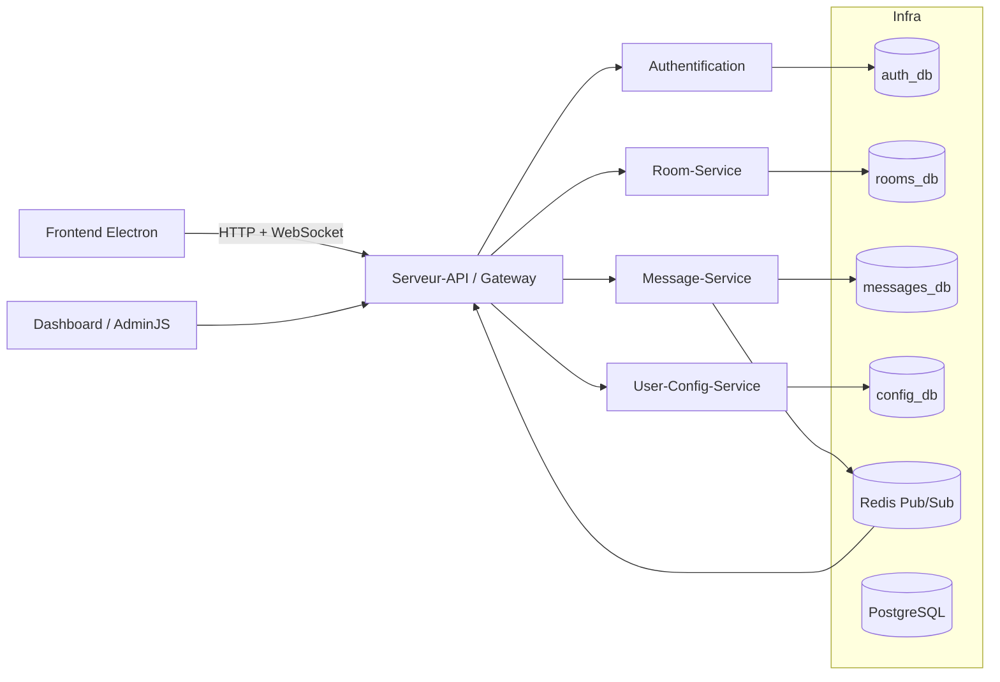

# Architecture C2

Le Dashboard est l'application AdminJS du dépôt `A26_5A6_01-Dashboard`; Infra orchestrera son conteneur lorsque l'intégration de tous les repos sera activée (il n'est pas encore dans `docker-compose.yml`). AdminJS n'est pas une responsabilité métier d'Infra.

Le service `adminer` (port `8080`) du Compose est distinct : c'est un outil générique d'inspection PostgreSQL réservé au développement, pas le Dashboard.

## Choix d'orchestration

Décisions prises lors des revues de PR, à relire avant de les remettre en cause.

- **Adminer sans profil Compose.** Tout ce Compose est un environnement de développement : identifiants de dev, ports liés à `127.0.0.1`. Adminer démarre donc avec `docker compose up`, sans `--profile dev`. Un profil sera à ajouter si ce Compose sert un jour de base à un environnement partagé.
- **Pas de `NODE_ENV` pour Message-Service, User-Config-Service ni Serveur-API.** Leur code ne lit pas `NODE_ENV` et n'exige pas HTTPS pour `AUTH_SERVICE_URL`. Leur Dockerfile fixe `NODE_ENV=production`, ce qui convient. Seul `room-service` reçoit `NODE_ENV=development`, pour autoriser l'URL HTTP interne d'Auth (voir le README). Ne l'ajouter à un autre service que si son code l'exige.
- **`TRUST_PROXY=false` est sûr.** Serveur-API compare explicitement la chaîne : `true` ou `false`, toute autre valeur fait échouer le démarrage. La chaîne `"false"` n'est donc jamais évaluée comme vraie.
- **Aucune valeur n'est interpolée par le shell dans le SQL d'initialisation.** `postgres/init/00-create-databases.sh` passe base, rôle et mot de passe à `psql -v`, dans un heredoc quoté. psql échappe lui-même les valeurs (`:'var'`, `:"var"`). Les noms de base et de rôle sont en plus limités à `[A-Za-z0-9_]`. Remarque : même l'ancien heredoc non quoté n'exécutait pas un `$(...)` contenu dans une variable, car le shell ne réévalue pas le résultat d'une expansion.
- **Rôle existant : mot de passe réaligné.** Le script d'init ne s'exécute normalement que sur un volume neuf. S'il est rejoué à la main, il fait `ALTER ROLE ... PASSWORD` au lieu d'ignorer le rôle existant, pour rester aligné avec `.env`.
- **Healthcheck d'Auth avec `curl` et `|| exit 1`.** L'image finale d'Auth-Service est `node:20.19.1-bookworm-slim` (et non Alpine). Une image Node pour un binaire Rust est voulue : le conteneur exécute `npx prisma migrate deploy` avant de lancer le binaire (voir le Dockerfile d'Authentification). Ce Dockerfile installe `curl` explicitement. Le `|| exit 1` n'est pas redondant : Docker n'attend que 0 (sain) ou 1 (malade), alors que `curl` peut renvoyer d'autres codes (par exemple 7 si la connexion est refusée).
- **`start_period` de 10 s suffisant.** Le build des images a lieu avant le démarrage des conteneurs, il ne compte donc pas. Les échecs pendant `start_period` ne sont pas comptés, puis `retries: 20` × `interval: 5s` laisse encore environ 100 s. Chaque service dispose donc d'environ 110 s pour exécuter ses migrations et répondre.
- **Secrets visibles dans `docker inspect` : accepté en dev.** Le mot de passe Redis (`--requirepass`) apparaît dans les arguments du conteneur, mais pas dans `ps` : Redis masque sa ligne de commande. `POSTGRES_PASSWORD`, les `DATABASE_URL` et `JWT_SECRET` sont de toute façon visibles dans `docker inspect`, via l'environnement. Déplacer uniquement Redis vers un `redis.conf` n'apporterait rien et créerait une seconde source de vérité hors `.env`. Avant tout environnement partagé, passer tous les services aux secrets Docker.
- **`scripts/healthcheck.sh` ne lit pas `.env`.** Les identifiants sont lus dans l'environnement des conteneurs (`POSTGRES_USER` pour postgres, `REDISCLI_AUTH` pour redis), que Docker Compose remplit à partir de `.env`. Docker Compose reste ainsi la seule source de vérité, et `.env` n'est jamais exécuté comme un script shell. Sans option, le script vérifie toute la stack ; `--infra` se limite à PostgreSQL et Redis.
- **Healthchecks Node avec `fetch()` natif.** Room-Service, Message-Service, User-Config-Service et Serveur-API utilisent tous `node:22-alpine`, et `fetch` est disponible sans option depuis Node 18. Si l'un d'eux passait sous Node 18, remplacer son healthcheck par `wget -qO- …`.
- **Healthcheck Redis : `grep -q PONG` sans `-x`.** `redis-cli ping` répond exactement `PONG`, et une erreur (mauvais mot de passe, serveur arrêté) ne contient pas ce mot. Le cas d'une erreur contenant « PONG » reste théorique ; `-x` n'apporterait rien de concret.
- **Une seule variable CORS dans `.env`.** Tous les services, Auth-Service compris, lisent `CORS_ORIGINS` ; de même, Room-Service et Message-Service lisent tous deux `AUTH_SERVICE_TIMEOUT_MS`. Aucun renommage dans le Compose : les listes ne peuvent pas diverger. Tous ces services lisent le même format : origines séparées par des virgules, espaces retirés, entrées vides ignorées.
- **Workflow de revue épinglé.** Dans `.github/workflows/claude-review.yml`, les actions sont épinglées sur un SHA de commit (avec la version en commentaire) et les CLI npm sur une version exacte. Ce workflow a accès aux jetons Claude/Copilot et à l'écriture des PR : un tag ou un paquet republié par un tiers ne doit pas pouvoir s'y exécuter. La procédure de mise à jour est en tête du fichier. Les étapes Claude et Copilot ont `timeout-minutes: 15` : un blocage n'occupe plus un runner pendant 6 h (la limite par défaut de GitHub).
