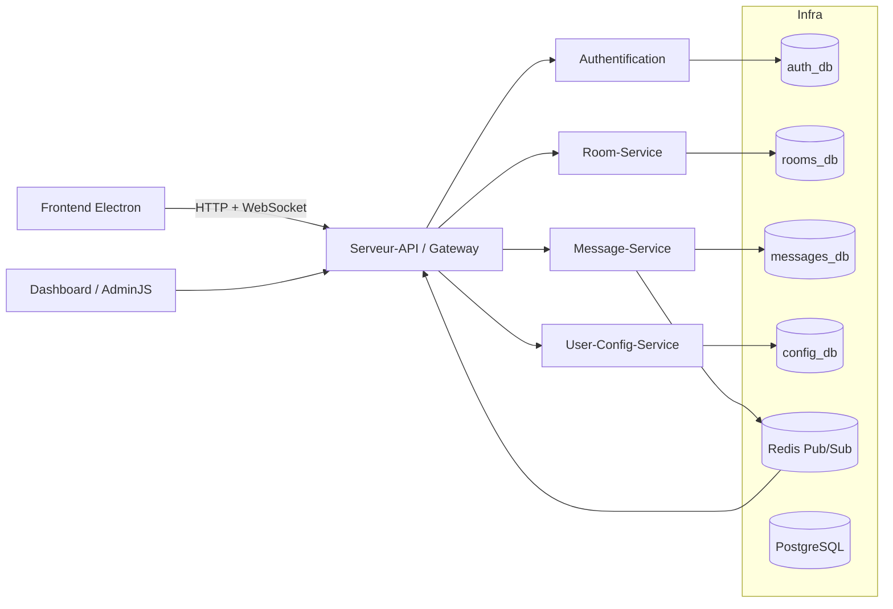

# Architecture C2

Le Dashboard est l'application AdminJS du dépôt `A26_5A6_01-Dashboard`; Infra orchestrera son conteneur lorsque l'intégration de tous les repos sera activée (il n'est pas encore dans `docker-compose.yml`). AdminJS n'est pas une responsabilité métier d'Infra.

Le service `adminer` (port `8080`) du Compose est distinct : c'est un outil générique d'inspection PostgreSQL réservé au développement, pas le Dashboard.

## Choix d'orchestration

Décisions prises lors des revues de PR, à relire avant de les remettre en cause.

- **Adminer sans profil Compose.** Tout ce Compose est un environnement de développement : identifiants de dev, ports liés à `127.0.0.1`. Adminer démarre donc avec `docker compose up`, sans `--profile dev`. Un profil sera à ajouter si ce Compose sert un jour de base à un environnement partagé.
- **Pas de `NODE_ENV` pour Message-Service, User-Config-Service ni Serveur-API.** Leur code ne lit pas `NODE_ENV` et n'exige pas HTTPS pour `AUTH_SERVICE_URL`. Leur Dockerfile fixe `NODE_ENV=production`, ce qui convient. Seul `room-service` reçoit `NODE_ENV=development`, pour autoriser l'URL HTTP interne d'Auth (voir le README). Ne l'ajouter à un autre service que si son code l'exige.
- **`TRUST_PROXY=false` est sûr.** Serveur-API compare explicitement la chaîne : `true` ou `false`, toute autre valeur fait échouer le démarrage. La chaîne `"false"` n'est donc jamais évaluée comme vraie.
- **Aucune valeur n'est interpolée par le shell dans le SQL d'initialisation.** `postgres/init/00-create-databases.sh` passe base, rôle et mot de passe à `psql -v`, dans un heredoc quoté. psql échappe lui-même les valeurs (`:'var'`, `:"var"`). Les noms de base et de rôle sont en plus limités à `[A-Za-z0-9_]`. Remarque : même l'ancien heredoc non quoté n'exécutait pas un `$(...)` contenu dans une variable, car le shell ne réévalue pas le résultat d'une expansion.
- **Rôle existant : mot de passe réaligné.** Le script d'init ne s'exécute normalement que sur un volume neuf. S'il est rejoué à la main, il fait `ALTER ROLE ... PASSWORD` au lieu d'ignorer le rôle existant, pour rester aligné avec `.env`.
- **`scripts/healthcheck.sh` ne lit pas `.env`.** Les identifiants sont lus dans l'environnement des conteneurs (`POSTGRES_USER` pour postgres, `REDISCLI_AUTH` pour redis), que Docker Compose remplit à partir de `.env`. Docker Compose reste ainsi la seule source de vérité, et `.env` n'est jamais exécuté comme un script shell.
