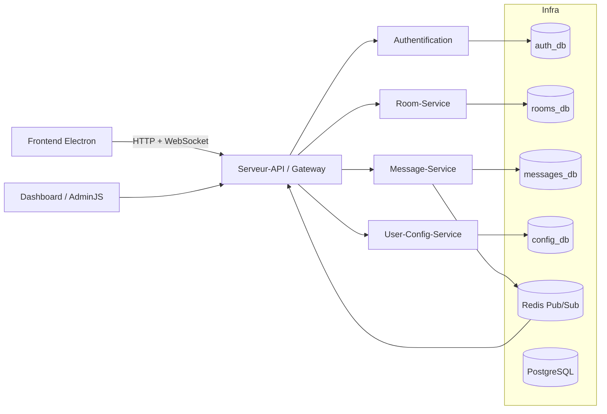

# Architecture C2

Le Dashboard est l'application AdminJS du dépôt `A26_5A6_01-Dashboard`; Infra orchestrera son conteneur lorsque l'intégration de tous les repos sera activée (il n'est pas encore dans `docker-compose.yml`). AdminJS n'est pas une responsabilité métier d'Infra.

Le service `adminer` (port `8080`) du Compose est distinct : c'est un outil générique d'inspection PostgreSQL réservé au développement, pas le Dashboard.
